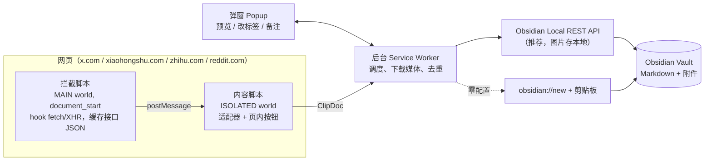

# kb-clipper 设计文档

> 版本：v0.1 草案（2026-10-02）
> 目标：Chrome 插件，把网上看到的内容抓成干净的 Markdown + 本地图片/视频，存进 Obsidian。
> 平台顺序：X/推特 → 小红书 → 知乎 → Reddit，其它网页走通用兜底。

---

## 1. 设计原则

1. **存全，不存链接。** 知识库最怕链接失效、帖子被删、图片过期（小红书图片带签名会过期，知乎图片有防盗链）。图片默认下载到本地，视频能拿到直链的也下载。
2. **优先用页面已经拿到的数据，DOM 只做兜底。** 页面打开时浏览器已经请求过接口（X 的 GraphQL、小红书的 feed），我们只是“顺手”读一份，**不额外发请求，不碰签名接口**，几乎没有封号风险。
3. **每个平台一个适配器，输出统一的数据结构。** 渲染、存储、去重全部共用，新增平台只写适配器。
4. **一键保存，可选预览。** 默认快捷键直接存；需要改标签、写备注时再打开弹窗。
5. **不依赖任何服务器、不需要 API Key。** 全部在本机完成。

---

## 2. 总体架构



一次保存的流程：

1. 用户按快捷键 / 点弹窗 / 右键 / 点页内按钮。
2. 后台通知当前页的内容脚本：“抓这个”。
3. 内容脚本找到匹配的平台适配器，按 **拦截缓存 → 页面内嵌数据 → DOM → Defuddle** 的顺序取数据，产出 `ClipDoc`。
4. 后台查去重索引，看是新建还是更新。
5. 后台下载图片/视频（带并发和大小限制）。
6. 渲染 Markdown（frontmatter + 正文，媒体引用改成 `![[本地文件]]`）。
7. 通过 Local REST API（或 obsidian:// URI）把 `.md` 和附件写进 Vault，更新去重索引，弹出“已保存”的提示（可点击在 Obsidian 中打开）。

---

## 3. 技术选型

| 项 | 选择 | 理由 |
|---|---|---|
| 框架 | **WXT**（Manifest V3，内置 Vite、热重载） | ZJ-clipper、download-zhihu 都用它或同类工具，开发体验最好 |
| 语言 | TypeScript | |
| 弹窗/设置页 UI | Preact（或 React） | 只给弹窗和设置页用，内容脚本不带框架，保持轻量 |
| 通用正文提取 | [Defuddle](https://github.com/kepano/defuddle)（MIT） | Obsidian 官方剪藏在用，内置 X、Reddit 等提取器，用来兜底 |
| HTML → Markdown | Turndown + 自定义规则 | 知乎公式、脚注、卡片要专门处理 |
| 测试 | Vitest + 真实接口 JSON 夹具 | 参考 XClipper：把真实响应存成 fixture，测“JSON → ClipDoc → Markdown” |

**许可证注意：** ZJ-clipper（保留所有权利）和 XClipper（非商用）**只借鉴思路，不复制代码**。Defuddle、obsidian-clipper、download-zhihu 是 MIT，可以引用或改写，需保留版权声明。

---

## 4. 统一数据结构 `ClipDoc`

所有适配器只负责产出这个结构，不关心怎么渲染、存到哪里。

```ts
interface ClipDoc {
  platform: 'x' | 'xiaohongshu' | 'zhihu' | 'reddit' | 'web';
  kind: 'post' | 'thread' | 'article' | 'answer' | 'note' | 'pin' | 'page';
  id: string;                 // 平台内唯一 ID：tweetId / noteId / answerId / reddit id
  url: string;                // 规范化后的永久链接（去掉跟踪参数）
  title: string;              // 没有标题的取正文前 30 字
  author: { name: string; handle?: string; url?: string; avatar?: string };
  published?: string;         // ISO 时间
  updated?: string;
  lang?: string;
  tags: string[];             // 平台自带标签：话题、subreddit、知乎话题
  stats?: { likes?: number; reposts?: number; replies?: number; collects?: number;
            views?: number; bookmarks?: number; score?: number };
  body: string;               // Markdown，媒体位置用占位符 {{media:N}}
  media: MediaItem[];
  quoted?: ClipDoc;           // 引用推文 / 被转发内容
  parts?: ClipDoc[];          // 线程：作者自己连续回复的推文
  comments?: CommentNode[];   // 可选：评论（Reddit、小红书、知乎）
  extra?: Record<string, unknown>; // 平台特有字段，如小红书 IP 属地、Reddit subreddit
  source: 'intercept' | 'state' | 'dom' | 'defuddle'; // 数据来源，方便排查
}

interface MediaItem {
  kind: 'image' | 'video' | 'gif' | 'live-photo';
  url: string;          // 最高清的地址
  poster?: string;      // 视频封面
  alt?: string;
  width?: number; height?: number;
  downloadable: boolean; // blob/HLS 流为 false，只存封面 + 原帖链接
}

interface CommentNode {
  author: string; text: string; likes?: number; published?: string;
  children?: CommentNode[];
}
```

为什么正文里用 `{{media:N}}` 占位符：同一份数据既能渲染成“本地附件”`![[x-123-1.jpg]]`，也能渲染成“远程链接”``，下载失败时自动退回远程链接，不需要改适配器。

---

## 5. 数据获取：分层兜底

| 层 | 方法 | 适用 | 参考 |
|---|---|---|---|
| ① 拦截缓存 | MAIN world 脚本在 `document_start` 时 hook `fetch` 和 `XMLHttpRequest`，接口返回时复制一份 JSON，按 ID 缓存在内存里 | X、小红书 | xiaohongshu-content-collector 的 `injector.js`；XClipper 的 GraphQL → AST |
| ② 页面内嵌数据 | 读 `<script>` 里的初始状态 | 知乎 `script#js-initialData`、小红书 `window.__INITIAL_STATE__`（直接打开笔记链接时） | download-zhihu 的 `detector.ts` |
| ③ 同源公开 JSON | 页面上下文直接 fetch | Reddit `帖子链接.json?raw_json=1` | reddit-markdown-exporter |
| ④ DOM | 选择器读已渲染的页面 | 所有平台兜底 | ZJ-clipper 各适配器 |
| ⑤ Defuddle | 通用正文提取 | 其它网站、或以上全失败 | defuddle |

拦截脚本和内容脚本之间用 `window.postMessage` 通信，消息带固定标记，内容脚本只接收同窗口、带标记的消息。拦截只做**观察**，绝不修改请求和响应。

---

## 6. 各平台适配器

### 6.1 X / 推特（第一期）

**要支持的内容：**

| 类型 | 说明 |
|---|---|
| 单条推文 | 正文、图片、视频、GIF、外链卡片、投票 |
| 长推文 | Premium 长文本在 `note_tweet` 字段，DOM 里会被截断，必须用接口数据 |
| 引用推文 | 作为 `quoted` 嵌在正文下方，用引用块渲染 |
| 线程 | 作者对自己的连续回复，合并成一篇 |
| X Article（长文） | 标题、段落、标题层级、图片、代码块 |
| 时间线上的推文 | 不用点进详情页也能存（时间线接口已缓存了数据） |

**数据来源（按优先级）：**

1. **拦截 GraphQL**：`TweetDetail`（详情页）、`HomeTimeline` / `UserTweets` / `Bookmarks` / `Likes`（时间线）。从 `tweet_results.result` 读取：
   - 文字：`note_tweet.note_tweet_results.result.text` 优先，否则 `legacy.full_text`。
   - `t.co` 短链：用 `entities.urls[].expanded_url` 换成真实地址（不需要联网解析）。
   - 媒体：`legacy.extended_entities.media[]`。图片在地址后加 `?name=orig` 取原图；视频从 `video_info.variants` 里取码率最高的 mp4，**可以直接下载**（DOM 里只有 blob，拿不到）。
   - 作者：新版本在 `core.user_results.result.core`，旧版本在 `legacy`，两处都要读（参考 XClipper 的防御式读取）。
   - 线程：`TweetDetail` 里，焦点推文前后同作者、连续的 `self_thread` 推文。
2. **DOM 兜底**：`article[data-testid="tweet"]`、`[data-testid="tweetText"]`、`[data-testid="tweetPhoto"] img`、`time[datetime]`；X Article 读 `[data-testid="twitterArticleRichTextView"]`，交给 Defuddle 的 XArticle 提取器。
3. **注意**：沉浸式翻译等插件会往推文里插译文节点，DOM 兜底时要先剥掉（ZJ-clipper 踩过的坑）。

**线程判定规则：** 从焦点推文向上、向下，取**视觉上连续、同一作者**的推文；碰到别人的回复就停。硬上限 100 条。

**文件名：** `2026-10-02 @handle 正文前30字.md`

### 6.2 小红书（第二期）

**要支持：** 图文笔记（多图）、视频笔记、Live 图；可选抓已加载的评论。

**数据来源：**

1. **拦截** `/api/sns/web/v1/feed`（点开笔记浮层时请求）：`note_card` 里有 `title`、`desc`、`image_list[].url_default`、`video.media.stream.h264[0].master_url`、`interact_info`、`tag_list`、`ip_location`、`time`。
2. **页面初始状态**：直接打开 `/explore/<noteId>` 时，读 `window.__INITIAL_STATE__.note.noteDetailMap[noteId].note`（MAIN world 读，第一期开发时用真实页面验证字段）。
3. **DOM 兜底**：`#noteContainer`、`#detail-title`、`#detail-desc`、`.swiper-slide img`（排除 `swiper-slide-duplicate` 和头像）。笔记 ID 从 `note-id` 属性或 URL 取。

**要点：**
- 笔记是**浮层**盖在信息流上，必须锁定当前可见的笔记，不能抓到背后的信息流。
- 正文里的 `#话题[话题]#` 转成 tags。
- 图片链接带签名、会过期 → **必须下载到本地**。
- 检测到登录/滑块验证弹窗时，提示用户先处理，不硬抓。

### 6.3 知乎（第三期）

**要支持：** 回答、专栏文章、想法；问题页只抓问题描述 + URL 指定的那一条回答。

**数据来源：** `script#js-initialData` 和 DOM **两边都取，用内容更长的那份**（initialData 有时会截断长文，download-zhihu 的经验），时间信息用 initialData 补全。

**HTML → Markdown 特殊规则（参考 download-zhihu，MIT）：**

| 知乎元素 | 识别方式 | 转成 |
|---|---|---|
| 行内公式 | `img[eeimg="1"]` / `span[data-eeimg]` 的 `data-tex` 或 `alt` | `$...$` |
| 块级公式 | `eeimg="2"` | `$$...$$` |
| 高清图 | `data-original` > `data-actualsrc` > `src` | 下载本地 |
| 脚注 | `sup[data-text][data-url]` | Markdown 脚注 `[^n]` |
| 链接卡片 | `a.LinkCard` | `[标题](链接)` |
| 视频 | `a.video-box` | 封面 + 链接 |
| 目录 | `.Catalog` | 删掉 |
| 外链跳转 | `link.zhihu.com/?target=` | 解码成真实地址 |

**多回答页面**：必须用 URL 里的 answer id 锁定那一条，找不到就报错，不能拿第一条回答冒充（ZJ-clipper 的教训）。

### 6.4 Reddit（第四期）

**数据来源：** 在页面里直接请求 `帖子永久链接.json?raw_json=1`（同源、带登录态，是 Reddit 官方公开的格式），一次拿到帖子和整棵评论树。失败时读 `<shreddit-post>` 元素的属性（`post-title`、`author`、`score`、`created-timestamp`）加 `[slot="text-body"]`。

**要点：**
- 正文是 `selftext`（Markdown 原文，直接用）。
- 图集：`gallery_data.items` 按顺序对应 `media_metadata`。
- 视频：`secure_media.reddit_video` 是 DASH，音画分离 → 只存封面 + 链接（以后再考虑）。
- 评论：默认存**得分最高的 20 条一级评论 + 每条最多 3 层回复**，可在设置里调或关闭。
- subreddit 作为 tag。

### 6.5 通用网页（顺带）

其它网站直接用 Defuddle 提取正文，存到 `AllClip/Web/`。成本几乎为零，先有个兜底。

---

## 7. 存进 Obsidian

### 7.1 三种写入方式

| 方式 | 原理 | 图片/视频 | 需要 Obsidian 开着吗 | 结论 |
|---|---|---|---|---|
| A. 直接写文件夹（未采用） | Chrome 的 File System Access API：设置页里选一次 Vault 文件夹，句柄存进 IndexedDB，之后直接写文件 | ✅ 二进制都能写 | ❌ 不需要，Obsidian 打开时自动刷新 | 未采用，见第 13 节 |
| **B. Local REST API 插件** | Obsidian 装 [Local REST API](https://github.com/coddingtonbear/obsidian-local-rest-api) 插件，`PUT /vault/路径` | ✅ | ✅ 必须开着 | **推荐** |
| C. `obsidian://new` URI | 官方剪藏的做法，内容走剪贴板 | ❌ 只能放远程链接 | ✅ | 零配置模式 |

**写入细节（参考 ZJ-clipper `utils/rest.ts`、obsidian-clipper `obsidian-note-creator.ts`）：**
- REST：`PUT {baseUrl}/vault/{路径}` 写 Markdown 和图片二进制，`Authorization: Bearer <key>`；`GET /vault/{路径}` 判断文件是否存在。默认地址 `http://127.0.0.1:27123`（插件需开启 HTTP 服务）。
- URI：先把内容写进剪贴板，再打开 `obsidian://new?file=…&vault=…&clipboard`；剪贴板失败时退回 `&content=` 参数。

### 7.2 Vault 里的目录结构（可在设置里改）

```
<Vault>/
└── AllClip/
    ├── X/
    │   └── 2026-10-02 @karpathy 关于 LLM 训练的一些想法.md
    ├── 小红书/
    │   └── 2026-10-02 某某 东京三日游攻略.md
    ├── 知乎/
    ├── Reddit/
    ├── Web/
    └── _assets/
        ├── x/1843xxxx-1.jpg
        ├── x/1843xxxx-v1.mp4
        └── xiaohongshu/66fxxxx-1.webp
```

附件按“平台/内容 ID-序号”命名，同一条内容重复保存时直接覆盖，不会越存越多。

### 7.3 笔记格式

所有平台的 frontmatter 字段统一，方便用 Dataview / Bases 查询：

```markdown
---
title: "关于 LLM 训练的一些想法"
platform: x
kind: thread
source: https://x.com/karpathy/status/1843000000000000000
id: "1843000000000000000"
author: "Andrej Karpathy"
author_handle: "@karpathy"
author_url: https://x.com/karpathy
published: 2026-09-30T14:21:00Z
clipped: 2026-10-02T10:05:12+08:00
tags: [allclip/x]
likes: 9123
reposts: 1500
replies: 284
status: inbox
---

正文……

![[_assets/x/1843000000000000000-1.jpg]]

> [!quote] 引用 @someone
> 被引用的推文内容……

---

## 我的备注

（弹窗里填的备注写在这里）
```

- `status: inbox` 方便以后做“待读 → 已读 → 已整理”的流程。
- 正文模板按平台各一份，存在设置里，第一版先写死，以后再开放自定义（obsidian-clipper 的模板系统可以参考）。

### 7.4 去重和更新

- 在 `chrome.storage.local` 里维护索引：`platform:id → 文件路径、保存时间`。
- 再次保存同一条内容时，弹窗提示“已于某天保存过”，可选**更新**（覆盖正文和数据，保留“我的备注”部分）或**跳过**。
- 索引丢了也不要紧：frontmatter 里有 `platform` + `id`，以后可以扫描 Vault 重建。

---

## 8. 交互设计

| 入口 | 行为 |
|---|---|
| 快捷键 `Alt+S` | 直接保存当前内容，右下角弹提示，不打断阅读 |
| 工具栏弹窗 | 显示识别到的内容（标题、作者、图片数、平台），可改标题、加标签、写备注、选是否带评论，然后保存 |
| 右键菜单 | 在推文/笔记上右键 →“保存到 Obsidian”，自动识别鼠标所在的那一条 |
| 页内按钮（第五期） | X 每条推文操作栏加一个保存图标，小红书笔记浮层加一个按钮；时间线上不用点进去就能存 |

弹窗状态：
- 支持的平台：显示预览卡片和“保存”按钮。
- 不支持的页面：显示“用通用模式保存”。
- 没设置 Vault：引导去设置页选文件夹。
- 已保存过：显示保存时间和“更新 / 在 Obsidian 中打开”。

---

## 9. 权限

```jsonc
{
  "permissions": ["storage", "activeTab", "scripting", "contextMenus", "notifications"],
  "host_permissions": [
    "https://x.com/*", "https://twitter.com/*", "https://pbs.twimg.com/*", "https://video.twimg.com/*",
    "https://www.xiaohongshu.com/*", "https://*.xhscdn.com/*",
    "https://*.zhihu.com/*", "https://*.zhimg.com/*",
    "https://www.reddit.com/*", "https://*.redd.it/*"
  ],
  "optional_host_permissions": ["<all_urls>"]  // 通用网页兜底时再申请
}
```

不申请 `webRequest`，不读 cookie，不读 X 的鉴权头（XClipper 的批量加速功能需要这些，我们暂时不做批量）。

---

## 10. 代码结构

```
kb-clipper/
├── wxt.config.ts
├── entrypoints/
│   ├── background.ts            # 调度、下载媒体、去重、右键菜单、快捷键
│   ├── popup/                   # 弹窗
│   ├── options/                 # 设置页（选 Vault、目录、模板、评论开关）
│   ├── intercept.content.ts     # MAIN world，document_start，hook fetch/XHR
│   └── clip.content.ts          # ISOLATED world，适配器调度
├── src/
│   ├── core/
│   │   ├── types.ts             # ClipDoc / MediaItem / CommentNode
│   │   ├── registry.ts          # 适配器注册与匹配
│   │   ├── intercept-cache.ts   # 接口缓存（按 ID，LRU 上限 500 条）
│   │   └── html-to-md.ts        # Turndown + 通用规则
│   ├── adapters/
│   │   ├── x/        { graphql.ts, dom.ts, thread.ts, index.ts }
│   │   ├── xiaohongshu/ { api.ts, state.ts, dom.ts, index.ts }
│   │   ├── zhihu/    { initial-data.ts, dom.ts, rules.ts, index.ts }
│   │   ├── reddit/   { json.ts, dom.ts, index.ts }
│   │   └── web/      { defuddle.ts }
│   ├── render/
│   │   ├── frontmatter.ts
│   │   ├── markdown.ts          # ClipDoc → Markdown（各平台模板）
│   │   └── filename.ts          # 文件名清理、长度限制、去非法字符
│   ├── media/
│   │   └── download.ts          # 并发 4，单文件上限（默认图片 20MB、视频 200MB）
│   └── vault/
│       ├── writer.ts            # 接口：writeText / writeBinary / exists
│       ├── rest.ts              # 方案 B
│       └── uri.ts               # 方案 C
└── tests/
    ├── fixtures/                # 真实接口 JSON、页面 HTML 快照
    └── *.test.ts
```

---

## 11. 开发里程碑

> 2026-10-02：M0–M5 全部完成，实现细节以代码为准（与本节计划的差异：写入方式只做了 REST 和 URI；知乎评论未做；Reddit 未用真实数据验证）。

| 期 | 内容 | 完成标准 |
|---|---|---|
| **M0 骨架** | WXT 项目、设置页配置 Vault（REST / URI）、快捷键 + 弹窗 + 提示、Defuddle 通用模式 | 任意网页按 `Alt+S` 能在 Vault 里生成一篇带图片的笔记 |
| **M1 X** | GraphQL 拦截、单条/长推/引用/线程/Article、图片原图、视频 mp4、DOM 兜底、去重 | 10 条不同类型的真实推文都存对，fixture 测试通过 |
| **M2 小红书** | feed 拦截 + 初始状态 + DOM、多图/视频/Live 图、话题标签、可选评论 | 图文和视频笔记都能完整存下，图片本地化 |
| **M3 知乎** | 回答/文章/想法、公式/脚注/卡片规则、initialData 与 DOM 取长 | 带公式和脚注的长回答渲染正确 |
| **M4 Reddit** | `.json` 抓取、图集、评论树 | 帖子 + 前 20 条评论正确 |
| **M5 打磨** | 页内保存按钮、右键识别鼠标所在内容、模板自定义、选中文字只存选区 | |

之后可以考虑：X 书签/点赞批量导入、知乎收藏夹批量导出、存完自动调 AI 生成摘要和标签。

---

## 12. 风险

| 风险 | 应对 |
|---|---|
| 平台改版导致选择器/字段失效 | 三层数据来源互为兜底；所有字段读取都做防御；每个平台保留真实 fixture，改版时先补 fixture 再修 |
| X GraphQL 字段名变化 | 新旧字段路径都读（参考 XClipper 的处理） |
| Obsidian 没开 / REST 插件没启用 | 弹窗明确提示“连不上 Obsidian”，可一键改用 URI 方式保存 |
| 大视频拖慢保存 | 设上限，超过只存封面和链接；下载在后台进行，不阻塞正文写入 |
| 小红书风控 | 不主动请求任何接口，只读页面已有数据 |

---

## 13. 已确认的决定（2026-10-02）

1. Vault 里的根文件夹叫 **`AllClip/`**，平台子文件夹：`X/`、`小红书/`、`知乎/`、`Reddit/`、`Web/`，附件放 `AllClip/_assets/<平台>/`。
2. 评论：Reddit 默认存**得分最高的 10 条**一级评论；小红书、知乎默认不存，弹窗可勾选。
3. 视频：**默认不下载**，弹窗可勾选下载（上限 200MB）。
4. 写入方式：**参考 ZJ-clipper / Obsidian 官方剪藏的做法**，不用第 7.1 节的方案 A：
   - **Local REST API（推荐）**：图片可存本地附件，需在 Obsidian 装 Local REST API 插件；
   - **obsidian:// URI（零配置）**：内容走剪贴板交给 Obsidian，图片保留远程链接。
